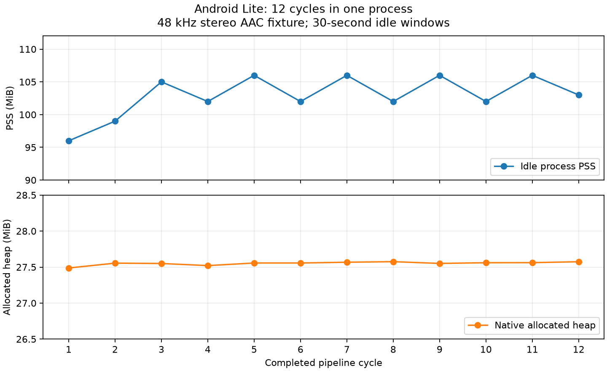

# Android engine verification

Alona runs local speech and notes models on Android through `@alona/engine`. Lite and Balanced use the same pinned model files as macOS. The Contract views, prompts, chunking, meeting storage, and engine protocol are unchanged.

## Verdicts

| Check | Verdict | Command and output tail |
|---|---|---|
| Unit tests and adapter | VERIFIED | `bun test`: `87 pass`, `0 fail` |
| APK build and real first launch | VERIFIED | `bun exact.mjs android`: `BUILD SUCCESSFUL`, installed on `emulator-5554`; bound probe: `false`, `sdk_gphone64_arm64 · Android 15 · 16 GB memory`, `balanced` |
| Model download, progress, and verification | VERIFIED | Initial `bun tools/e2e-android.mjs` and `balanced` preparations downloaded through the app; progress capture shows `Downloading Balanced · 37%`; the app then reported installed models |
| Lite inference | VERIFIED | `bun tools/e2e-android.mjs`: `4.2% (7 of 168)`, all five headings, `e2e: ok` |
| Balanced inference | VERIFIED | `bun tools/e2e-android.mjs balanced`: `4.8% (8 of 168)`, all five headings, `e2e: ok` |
| Idle memory after unload | VERIFIED, bounded warm state | `bun tools/e2e-android.mjs lite --cycles 12`: `e2e: ok`; cycles 4–12 idle PSS `102–106 MiB`; native allocated heap `27.49–27.58 MiB` across all 12 |
| Web demo flows | VERIFIED | `bun tools/flows.mjs web`: `6 passed, 0 failed` |
| Web verification | VERIFIED | `bun exact.mjs verify web`: `verify: clean`, `0 findings` |
| Android demo flows | VERIFIED | `bun tools/flows.mjs android`: `6 passed, 0 failed` |
| Android verifier | INCONCLUSIVE for its recorder checks | `bun exact.mjs verify android`: the tests passed; `3 problems (3 findings)`, each `resource rec was refused once` under recorder substitution |
| Backup exclusion and alignment | VERIFIED configuration | APK readback: `allowBackup=false`; package flags omit `ALLOW_BACKUP`; packaged rules exclude all app domains; `zipalign`: `Verification successful` |
| Independent runtime rebuild | VERIFIED on this Mac | `python3 tools/check-android-runtimes.py`: both artifacts `MATCH` in a second build directory |
| Clinic Android APK | NOT VERIFIED | `bun tools/tenant.mjs build default android --write-locks`: `the web engine is not built: run bun tools/build-web-engine.mjs`; coordinator action is described below |
| Real phone and hardware microphone | NOT VERIFIED | The tests use an emulator and an injected fixture |

The command logs and JSON results are in [docs/media/android-real](../media/android-real/). The three Android verifier findings are not a clean verifier result. They concern the agent's recorder substitution; the separate real-model runs and all Android demo flows passed.

## Runtime packages

The first route investigated was Maven Central. The source API of `dev.ffmpegkit-maintained:llama-android:0.1.1` exposes a chat-formatted, full-result call without token callbacks or cancellation. That API cannot preserve Alona's already wrapped prompt and partial-result protocol. The classes in `com.bihe0832.android:lib-sherpa-onnx:8.5.4` include Moonshine but omit VAD. Neither package is shipped. These were archive and API inspections, not device inference trials.

The engine uses the official [sherpa-onnx 2.0.1 AAR](https://github.com/k2-fsa/sherpa-onnx/releases/tag/v2.0.1) and a source build of [llama.cpp b12383](https://github.com/ggml-org/llama.cpp/releases/tag/b12383). `tools/build-android-runtimes.py` verifies both upstream archives by SHA-256. It builds the JNI writer with NDK 27.1.12297006 and publishes both AARs to `.exact/android-maven`. No native binary or model weight is committed.

The builder fixes ZIP timestamps, remaps source paths, strips debug data, and prevents CMake from reading the enclosing Alona Git repository. Before that last fix, upstream version headers contained Alona's commit and changed the AAR checksum after a commit. Both final AARs rebuilt byte for byte in an independent directory. `python3 tools/check-android-runtimes.py` repeats this check and writes `runtime-repro.json` and `runtime-repro.log` under `docs/media/android-real`.

The final AAR checksums are:

| AAR | SHA-256 |
|---|---|
| llama b12383 | `2d3c8c1064d2eb477042bdb7ae40076bc3e68715df0e9ee58f50e560c5602077` |
| sherpa 2.0.1 with JNI keep rules | `346ac64c7a5aa95e91cff1ef44626c1bf1aaa0406da4385fe5bc86d7c6e6ec7e` |

The first release inference failed because R8 renamed fields that sherpa JNI reads by name, including `decodingMethod`. The builder now adds consumer keep rules for `com.k2fsa.sherpa.onnx`. `r8-failure.log` preserves that failure. The custom llama library and all official arm64 sherpa libraries have 16 KB ELF alignment. The APK also passes `zipalign -c -P 16`, following the [Android 16 KB page-size guide](https://developer.android.com/guide/practices/page-sizes). Execution on a 16 KB-page device is not verified. The test emulator uses 4 KB pages.

The Rust route was not attempted. No Rust native-module shim is added, so the engine shares Kotlin's extension mechanism with recording and media capture.

## Exact patches and privacy

The shared Exact checkout is unchanged. `tools/prepare-android-exact.sh` makes an APFS copy and applies two patches to that dedicated copy:

- `tools/patches/android-local-maven.patch` adds the file repository selected by `ALONA_ANDROID_MAVEN`. Exact otherwise permits Google and Maven Central only.
- `tools/patches/android-private-backup.patch` disables app backup and excludes every app storage domain from cloud backup and device transfer.

The second patch fixes an observed privacy gap in the base Android host. The original installed APK had `ALLOW_BACKUP`, and its rules excluded locked secrets only. Ordinary meeting files remained eligible for backup. The final installed package has no `ALLOW_BACKUP` flag. Its packaged manifest has `allowBackup=false`, and its packaged extraction rules exclude all nine storage domains in both sections. See `backup-policy.txt`. No backup transport was invoked. Android documents these storage domains and transfer rules in [Auto Backup](https://developer.android.com/identity/data/autobackup).

Both patches are specific to the dedicated Alona build copy. The copy must not replace a general-purpose Exact installation. A future upstream integration should expose app-specific settings instead of changing backup defaults for every Exact app.

Models live in `Context.noBackupFilesDir/alona-models`, outside the meetings directory. Android excludes this directory from backup independently of the manifest patch. Downloads permit HTTPS only, check redirects and resumed ranges, enforce pinned sizes, and verify SHA-256 before rename. First verification in a process hashes the file. Later checks reuse that result only while the private immutable file's size, modification time, and expected checksum remain unchanged.

Downloads use an in-process worker. Work can continue while the process and engine session remain alive. Session destruction cancels it. Android can kill the process without completing the download. A later Download action resumes `.part` files. There is no foreground service or WorkManager, and background survival is not verified.

## Package and protocol

| File | Responsibility |
|---|---|
| `packages/alona-engine/exact.json` | Exact interface with one JSON string request and one JSON string reply |
| `android/EngineModule.kt` | Device facts, jobs, cancellation, removal, pruning, and operation dispatch |
| `android/ModelStore.kt` | Private model files, verified installation, and resumable HTTPS downloads |
| `android/Speech.kt` | Streaming platform audio decode, mono resampling, Silero VAD, and sherpa recognition |
| `native/Writer.cpp` | llama.cpp prompt evaluation, token callbacks, cancellation checks, and resource release |
| `core/host.ts` | Existing native probe followed by the generated Android package binding through a tested JSON adapter |

Every protocol operation has an implementation: `probe`, `installed`, `download`, `remove`, `transcribe`, `generate`, `job`, `cancel`, and `unload`. A running or completed job ID returns its existing view. A failed ID can run again. Unknown IDs return `unknown`. Removal cancels matching work, deletes the artifact, and forgets its download job. The registry retains at most 64 finished jobs. Running jobs are not pruned.

One worker serializes inference, downloads, and deletion. A separate reader checks installation so a download does not block progress polls. A concurrent model download can therefore delay an inference request. Speech and writer models are released before their jobs report completion. No model stays loaded between jobs.

`MediaExtractor` and `MediaCodec` decode audio in bounded buffers. The decoder folds channels to mono and preserves resampling phase across buffers. Silero VAD closes speech at silence or 20 seconds. Sherpa decodes each closed stretch. An hour's PCM is never stored in a single array. Linear resampling has no anti-alias filter, so accuracy on real microphone recordings still needs testing.

The writer receives the prompt with its chat markup already applied. It checks cancellation between prompt batches and tokens. UTF-8 byte callbacks expose partial text through `job`. Native model, context, and sampler resources have deterministic destruction.

The probe reports Android memory, core count, free storage, OS and model description, and screen form factor. It prefers `advertisedMem` when available. This AVD advertises 16 GB while the kernel exposes about 8 GB usable RAM. The protocol has only `phone` and `desktop`, so tablets map to `desktop`. GPU inference is disabled.

## Rebuild and run checks

The commands below use Bun 1.4.2, Python 3.12 or later, the supplied SDK, and `ffmpeg` for the AAC fixture.

```sh
export PATH="$HOME/.bun-1.4.2/bin:$HOME/Library/Android/sdk/platform-tools:$PATH"
export ANDROID_HOME="$HOME/Library/Android/sdk"
export JAVA_HOME="$HOME/.sdkman/candidates/java/current"
bun install
python3 tools/build-android-runtimes.py
eval "$(sh tools/prepare-android-exact.sh)"
bun exact.mjs android
bun tools/e2e-android.mjs
bun tools/e2e-android.mjs balanced
```

The committed Gradle lock and verification files match the final artifacts. For an intentional dependency change, run `bun exact.mjs android --write-locks`, review the generated metadata, and then run the normal strict build. The default copy is `/tmp/alona-android-exact`. `ALONA_EXACT_SOURCE` and `ALONA_EXACT_COPY` select other paths. The helper excludes changing build outputs while making the APFS copy.

The check waits for `setup.demo == false`; the baked `setup.ready` placeholder is not proof of a real reply. The e2e script imports the selected Exact checkout's `scripts/agent-session.mjs` and `scripts/agent-inspect.mjs`. It uses the same device driver as the CLI, with an adaptive loop that stops polling when the job completes.

For the AVD used here, the image is `system-images;android-35;google_apis;arm64-v8a`. Create a new AVD if the name is not already present:

```sh
$ANDROID_HOME/cmdline-tools/latest/bin/sdkmanager 'system-images;android-35;google_apis;arm64-v8a'
echo no | $ANDROID_HOME/cmdline-tools/latest/bin/avdmanager create avd -n Alona_Engine_Root -k 'system-images;android-35;google_apis;arm64-v8a' -d pixel_9
$ANDROID_HOME/emulator/emulator -avd Alona_Engine_Root -no-window -no-audio -gpu swiftshader_indirect -no-snapshot -memory 8192
```

Run the last command in a separate terminal. Stop the emulator you started with `adb emu kill` when finished.

Use a separate arm64 `google_apis` AVD with 8 GB RAM and `adb root`. A Play Store image refuses root. This task created `Alona_Engine_Test` and `Alona_Engine_Root`. Existing AVDs were not changed. The rootable AVD held both model tiers.

Exact checks source freshness across the repository. Finish source edits before building and driving. Several development attempts hit this guard. The final checks use rebuilt APKs.

## Demo captures and clinic

Under Exact's agent, an unbound `engine` selects demo inference. `bun tools/flows.mjs android` therefore remains fast and passes all six flows. `--bind engine` selects real inference. Outside the agent, inference is real by default. A `demo-engine` file in the current `app:/data` directory explicitly selects demo too. The recorder package has its own binding.

Clinic's generator inherits the root package dependencies, including `@alona/engine`. Its Android manifest template names the same Maven coordinates, and `clinic/app.ts` calls the shared host selector. The native engine does not contain Alona headings or tenant-specific prompts. The generator also copies the root Gradle locks and verification metadata. Each tenant has its own private model directory. The prepared Exact copy and `ALONA_ANDROID_MAVEN` apply to clinic too.

The standard command `bun tools/tenant.mjs build default android --write-locks` stopped before compilation: `the web engine is not built: run bun tools/build-web-engine.mjs`. At `tools/tenant.mjs:233`, generation unconditionally requires `modules/web/worker.js`, including for Android. The clinic APK is **NOT VERIFIED**. The coordinator must make this prerequisite conditional on the web target, or build the web worker before generation. That gate change is outside the allowed manifest-only edits. No web file was changed for this task.

## Measurement method

The check records a short agent take, then replaces that take with `tools/fixture/meeting-fixture.wav`, encoded locally as 48 kHz stereo AAC in an M4A container. It restores ownership and invokes **Transcribe again**. This avoids emulator microphone injection and exercises platform AAC decoding, resampling, downmixing, the real pipeline, and real models.

The fixture is synthetic speech, easier than a real room. WER is word-level edit distance after lowercase and punctuation stripping, without number normalization. Timing uses wall time and one-second status polls. Stage times have about one-second resolution. Timing includes model loading and pipeline overhead. Host load varied, so these figures do not predict phone latency.

Memory is app-process `dumpsys meminfo` TOTAL PSS sampled once per second in MiB. PSS apportions shared pages among processes. It is not exclusively owned RAM. Peak PSS is the largest observed sample, not a guaranteed instantaneous maximum. Idle PSS is the lowest sample in the final ten seconds of a 30-second idle window. All cycles in each run use one process. Native and Java allocated-heap columns are separate diagnostics.

The initial fixed-operation check continued reading state after completion. Those results are preserved as `e2e-lite-fixed-polls.json` and `e2e-balanced-fixed-polls.json`. The final adaptive check stops at completion. Raw memory samples are in its JSON output. `e2e-lite-soak.json` contains the separate 12-cycle run, and `memory-soak.png` plots its idle measurements.

## Measured runs

These are the final three-cycle checks on arm64 API 35, Android 15, with four virtual cores and about 8 GB usable RAM. WER uses synthetic speech, easier than a real room. The first cycle includes cold runtime setup.

| Tier | Synthetic WER | Cycle | Transcribe seconds | Notes seconds | Peak PSS MiB | Idle PSS MiB |
|---|---:|---:|---:|---:|---:|---:|
| Lite | 4.2% | 1 | 29.282 | 13.297 | 742 | 96 |
| Lite | 4.2% | 2 | 9.212 | 13.246 | 747 | 101 |
| Lite | 4.2% | 3 | 10.380 | 13.245 | 742 | 106 |
| Balanced | 4.8% | 1 | 31.404 | 36.943 | 1455 | 99 |
| Balanced | 4.8% | 2 | 11.225 | 37.804 | 1474 | 107 |
| Balanced | 4.8% | 3 | 11.245 | 36.779 | 1475 | 110 |

Both tiers produced `## Summary`, `## Key points`, `## Decisions`, `## Action items`, and `## Open questions`. The final Lite run includes the explicit non-demo startup guard.

The separate 12-cycle Lite soak had idle PSS of 96, 99, 105, 102, 106, 102, 106, 102, 106, 102, 106, 103 MiB. After startup, cycles 4–12 stayed between 102 and 106 MiB. Native allocated heap stayed between 27.49 and 27.58 MiB. The model allocation does not accumulate across these runs. The measurements show a bounded warm state, not identical PSS after every run or a proof about an unlimited run.



Nine real-model setup attempts started and stopped the agent recorder without a recorder-reply failure, for an observed rate of 0/9. This count includes the first R8-failing inference attempt and the successful encoding, soak, and final checks. Attempts rejected before recording by stale-build or model-selection checks are excluded. The agent creates synthetic recorder audio, so this is not a hardware microphone reliability measurement.

The first-launch check must wait for `setup.demo == false`. A previous capture read the baked demo placeholder while the real setup request was still pending. The corrected probe and the final e2e startup guard check the actual reply.

## Licenses

- sherpa-onnx is Apache-2.0. ONNX Runtime is MIT and carries its upstream third-party notices.
- llama.cpp and ggml are MIT. The statically linked NDK libc++ is Apache-2.0 with LLVM exceptions.
- [Moonshine](https://huggingface.co/UsefulSensors/moonshine) and [Silero VAD](https://github.com/snakers4/silero-vad) are MIT.
- [Qwen3.5](https://huggingface.co/Qwen/Qwen3.5-0.8B) is Apache-2.0.
- NVIDIA [Parakeet TDT 0.6B v3](https://huggingface.co/nvidia/parakeet-tdt-0.6b-v3) is CC-BY-4.0.

## Limits

Real phones, thermal behavior, long room recordings, 16 KB-page execution, interrupted-download resumption, background survival, cancellation under memory pressure, and store distribution are not verified. A finite soak is not a proof that no leak exists. The macOS regression attempt selected a cached binary from another checkout, so that attempt was stopped and supplies no macOS verdict.

No project feedback note was sent. The user prohibited sending project information to outside services. The workarounds and failures are recorded here instead.

## Changes outside the package

`core/host.ts` adds the tested transport adapter. `core/models.ts` adds Android entries for the two verified tiers. `core/core.test.ts` tests request encoding and reply validation. `app.json` and the clinic manifest template add Android Maven coordinates. `package.json` and `bun.lock` resolve the supplied Exact package paths from a worktree and include the engine. Gradle metadata locks both runtimes. The new tools build, prepare, reproduce, and drive the Android check. `tools/flows.mjs` documents its Android demo selection. No Contract view, Apple engine, web engine, desktop shell, tenant configuration, or explainer file changed.
