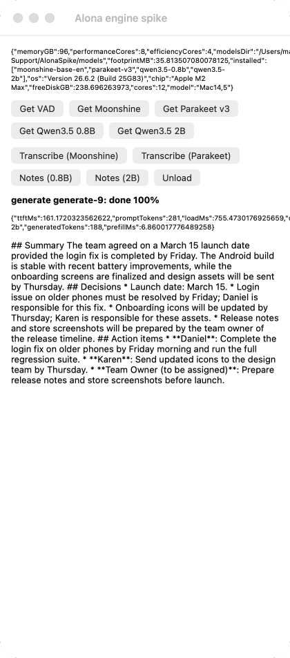

# Spike S2: the local engine on the macOS host

Date: 2026-11-14. Machine: Apple M2 Max (Mac14,5), 12 cores (8 performance, 4 efficiency), 96 GB, macOS 26.6.2, Xcode 26.1.1 (Swift 6.2.1). Exact checkout at commit `3baa28ff`. An Android build ran on the same machine the whole time, and the load average was 70 to 100, so every timing below is pessimistic and noisy.



## Verdict

| Acceptance line | Verdict | Evidence |
|---|---|---|
| The fixture transcribes in the launched macOS app through the seam (WER, wall time, RTF), Moonshine and Parakeet v3 | **VERIFIED** | Driven with `agent macos`. Moonshine WER 4.17%, Parakeet v3 WER 4.76%. See the numbers table. |
| The LLM writes notes with a summary, decisions and action items; TTFT and tokens/s for Qwen3.5-0.8B and 2B | **VERIFIED** | The in-app output is pasted below. 0.8B: TTFT 73–79 ms warm and 691 ms cold, 194–203 tok/s in the app. 2B: TTFT 161 ms, 99 tok/s in the app. |
| Peak memory per stage, and memory after `unload` across three full cycles, with the method | **VERIFIED, with a finding** | Unload returns to under 100 MB after the first cycle, but only to 475–676 MB after later cycles. `vmmap` shows the retained memory is freed `MALLOC_LARGE` pages the allocator keeps, not live models. |
| A screenshot of the working spike window | **VERIFIED** | `mac-engine.png` beside this file. |

The app builds only against a **patched copy** of Exact. At `3baa28ff`, Exact's own Swift (ExactCore, ExactKit, and the module seam) does not compile with Xcode 26.1.1 (Swift 6.2.1): 12 expressions hit the type-checker limit, and one is a type error. I split those expressions in an APFS clone of the checkout and built with `EXACT=<clone>`. The original checkout is unchanged (`git status` is clean). None of the edits change behavior. Details are under "What failed and why".

## Answers to the five questions

### 1. How third-party native code links into an Exact Apple app

Exact supports three routes today:

- **Vendor `.xcframework` beside the module's Swift.** This is what the spike uses.
  - `docs/contract-for-agents.md:4265-4278`: "Put vendor `.xcframework` bundles beside an Apple native module's Swift files… Static libraries are linked into the module. Dynamic frameworks are copied… into the app's `Frameworks` (`Contents/Frameworks` on macOS) and signed… Their install names must use `@rpath/<Name>.framework/…`."
  - `docs/recipes/app-json.md:20` says the same in one line.
  - The code is `scripts/app.mjs:531` (`frameworks: under('.xcframework')`, top level of `modules/apple` only) and `host/apple/arms.mjs:94-115` (`moduleFrameworks`). Each slice is linked with `-F <slice> -framework <name>`. Only a Mach-O dylib is embedded, and the rpath `@loader_path/../Frameworks` is added.
- **A package's Rust shim with a pinned prebuilt library.** A package's `exact.json` `native` block names `rust`, `class`, `link`, and a `library` entry `{url, sha256}` per target. For Apple, that entry is a zip of one dynamic `.xcframework`, which the build fetches, links and embeds (`docs/contract-for-agents.md:3064-3093`).
- **A Rust data crate** (`docs/reference.md:4106` onward, "Rust data sources"). Cargo dependencies with C++ (for example `llama-cpp-2` or `sherpa-onnx` crates) would build there. Two cautions: a data source answers the view's sources, not `native.later`, and the spike did not try this route.

**Swift Package Manager dependencies are not supported for app modules.** No doc, schema field or build path adds a `.package(url:)` to the module artifact. The module compiles with `xcrun swiftc` over the folder's own `.swift` files (`host/apple/build.mjs:1020-1048`). Swift files in subfolders are skipped with a warning, because "a module's Swift is the folder's own files, not its subfolders'" (`host/apple/build.mjs:1025`). FluidAudio and WhisperKit ship only as Swift packages, so using them means one of these:

- Vendor their sources as flat `.swift` files in `modules/apple`. This is feasible only if they have no resources or package dependencies of their own; FluidAudio needs Core ML model downloads but no SPM resources. Not tried.
- Build them into an `.xcframework` yourself with `xcodebuild -create-xcframework` from a framework target. Not tried.

**What linking actually required.** In the build the spike measured, three xcframeworks sit in `modules/apple/`:

| Framework | Source | Kind | Size in the module dylib |
|---|---|---|---|
| `sherpa-onnx.xcframework` | `sherpa-onnx-v2.0.1-macos-static.xcframework.zip`, k2-fsa `xcframework` release | static | Linked statically |
| `onnxruntime.xcframework` | `onnxruntime-macos-static-xcframework-1.28.2`, csukuangfj/onnxruntime-libs | static | Linked statically |
| `llama.xcframework` | `llama-b12383-xcframework.zip`, ggml-org | dynamic, `@rpath/llama.framework/Versions/Current/llama` | Embedded and signed in `Contents/Frameworks` |

`libexact_modules.dylib` is 39 MB, and `llama.framework` is embedded (checked with `otool -L` and `ls Contents/Frameworks`).

Three things were not obvious:

- The static sherpa archive does not contain onnxruntime. `OrtGetApiBase` is undefined, so onnxruntime needs its own static xcframework, matched to the onnxruntime version sherpa was built against (1.28.2 for sherpa-onnx 2.0.1).
- The static archives need `libc++`. I added `link "c++"` to SherpaOnnxC's module map in the vendored copy so the Swift import autolinks it. The supported way is app.json `host.macos.link` / `host.ios.link`: "Linker arguments for the app's native-module artifact… for what an archive in modules/apple/*.xcframework needs but cannot declare, such as -lc++" (`scripts/app.schema.json:808-811`, `:972-975`). The production module should use `link: ["-lc++"]` and leave the vendor module map untouched.
- The shared `sherpa-onnx-*-macos-shared*.xcframework` slices are bare `.dylib` files, not `.framework` bundles. `moduleFrameworks` accepts only a framework or `lib*.a` (`arms.mjs:101-103`), so those builds cannot be used as they ship.

**iOS.** The same mechanism applies, with per-platform module folders: `ios/modules/` or `macos/modules/` replaces `modules/apple` for that platform (`docs/contract-for-agents.md:4283-4287`). The llama xcframework already carries `ios-arm64`. sherpa-onnx and onnxruntime publish iOS static xcframeworks (`sherpa-onnx-v*-ios-static.xcframework.zip`, `onnxruntime-ios-static-xcframework-1.28.2`).

### 2. Where a recording from @exact/recording lands, and how the module reads it

- **Path.** `app:/data/...` maps to `~/Library/Application Support/exact/<app.id>/data/...`, or under the app group's root when there is one. Under an agent drive with `--storage <name>`, it maps to `~/Library/Caches/exact/<app.id>/agent/<name>/data` (`host/apple/src/picker.rs:42-59`). The recorder resolves its path with `context.file(path)` (`packages/recording/apple/Recording.swift:111`).
- **Format** (`packages/recording/apple/Recording.swift:8-12`, `:372-401`):
  - The default `audio/mp4` is AAC in a fragmented MP4 (one-second fragments) at the **capture device's native sample rate**, with `min(channels, 2)` channels.
  - `audio/wav` is 16-bit linear PCM at the device rate.
  - Nothing resamples to 16 kHz.
  - Under the agent, a stopped recorder's file is WAV of a synthetic tone.
- **The module reads it** with `AVAudioFile` and converts with `AVAudioConverter` to 16 kHz mono Float32 (`readPCM16k` in `Engine.swift`). I verified this path: a 48 kHz stereo AAC `.m4a` made from the fixture with `afconvert` transcribed with Moonshine at WER 2.98% (5/168), with 32 ms read-and-convert time for 53 s of audio. The difference from the 16 kHz WAV's 4.17% is two words on a 168-word sample, which is noise.
- **Not verified:** I did not record through `@exact/recording` itself. The device sample rate on this Mac and the real `app:/data` file of a live take were not observed.

### 3. Info.plist and entitlements for audio capture, Accessibility and Apple Events

- **The grant table.** Exact derives Info.plist keys and entitlements from grant rows. The table is `runner/src/device.rs:125-561` ("Every device grant. Adding a row is one entry here and no host code"). It has `microphone` (NSMicrophoneUsageDescription plus `com.apple.security.device.audio-input`), `microphone-background`, `notifications`, `login-item`, `global-shortcuts`, `speech-recognition` and others.
- **Missing rows.** It has **no row** for:
  - `NSAudioCaptureUsageDescription`, which Core Audio process taps (`CATapDescription`, `AudioHardwareCreateProcessTap`, as in `legacy/.../ProcessTap.swift:122-126` and `AudioRecorder.swift:197-202`) require.
  - Accessibility (`AXIsProcessTrusted`). It needs no plist key, so the TCC prompt works in an unsandboxed app, but nothing declares it.
  - Apple Events (`NSAppleEventsUsageDescription` and the hardened-runtime `com.apple.security.automation.apple-events`), which `MeetingDetector.swift:220` uses through `NSAppleScript` for Google Meet in Chrome.
- **Hand-written keys are refused.** `host.macos.infoPlist` and `entitlements` "refuse all supplied keys together" (`docs/reference.md:1481-1489`). A package's `plistKeys` only allows keys on `PLIST_KEYS` (`host/apple/plist.mjs:197-202`), which today holds one StoreKit key (`docs/contract-for-agents.md:3095-3108`).
- **The development build is not sandboxed.** `codesign -d --entitlements -` on the built `.app` printed no entitlements. So the model download in `Application Support/AlonaSpike` and the read of a `/private/tmp` fixture both worked. A distribution build gets hardened runtime, and I did not check whether it adds a sandbox.

Escape hatches, best first:

1. **Add grant rows upstream in Exact.** For example `device.audio-capture` deriving NSAudioCaptureUsageDescription, and `device.apple-events` deriving NSAppleEventsUsageDescription plus the automation entitlement. `device.rs:125` says a row is "one entry here and no host code". This is the clean fix, and it needs a change to Exact.
2. **A helper executable through `@exact/child-process`** (macOS and Linux only, under a `process.spawn path:<prog>` grant; `packages/child-process/README.md`). The helper can carry its own Info.plist through `-sectcreate __TEXT __info_plist`. Not verified: TCC usually attributes a child's capture to the responsible GUI app, so the prompt may still read Alona's Info.plist, which lacks the key. This needs a test.
3. **Embed ExactKit in a hand-owned Xcode app.** The docs refer to embedders (`session.hatchesOwnWindow`, `hatchesOwnProcess`, `docs/reference.md` hatch section). This gives full Info.plist control, but the app gives up Exact's build, signing and update pipeline. Not tried.

Feasibility of porting the legacy services into a module: the Swift itself ports directly (`ProcessTap.swift` is 306 lines, `AudioRecorder.swift` 808, `MeetingDetector.swift` 400). The usage-string gap above is the only blocker, and only for process taps and Apple Events.

### 4. Menu bar item, notifications, and NSWorkspace meeting detection

- **Menu bar item.** `-exact-menu="status"` on a button makes it the app's `NSStatusItem`. Its `popovertarget` menu becomes the item's menu (`docs/contract-for-agents.md:4171-4184`, `docs/contract-grammar.md:2793-2812`). `host.macos.activationPolicy: "accessory"` drops the Dock tile. Not built in this spike.
- **Notifications.** `@exact/notifications` has an Apple implementation that targets macOS (`packages/notifications/apple/exact.json`), with the grant row `notifications` (`device.rs:251`). Not exercised.
- **Meeting detection.** A Swift module can run `MeetingDetector`'s logic as it is: an `NSWorkspace.shared.notificationCenter` observer for `didActivateApplicationNotification` / `didLaunchApplicationNotification`, plus `runningApplications`. It then calls `context.changed("meetings")`, and every answer that called `native.watch("meetings")` is asked again (`host/apple/modules/ExactNativeModule.swift:164-169`). The spike uses this same push path for job progress, and it works (drive log: `changed (1 asked again)`). The Zoom-window check needs Accessibility, and the Chrome/Meet check needs Apple Events (see question 3).

### 5. Polling long jobs, and whether `later` survives the window closing

- **Push instead of polling.** Each `later` call gets one reply, so a long job returns a job id and the module calls `context.changed("jobs")`. It does so at most every 250 ms, and always at the end. The `jobStatus` source calls `native.watch('jobs')` and then `native.later({op:'status'})`, so the resource re-reads on each push. No `interval=` is needed.
  - This is verified in the launched app. The drive log shows `changed (1 asked again)` followed by a fresh `status` fulfil every few hundred ms while Moonshine ran.
  - A fixed `interval=` would also work, but it reads when nothing changed and lags when something did.
- **Window closing.** By default "a one-window Mac app ends when its window closes". With `"keepRunning": true` in `host.macos.window`, closing hides the window "and the app keeps running with its session and native module alive" (`docs/reference.md:488-512`). The module instance lives as long as its session and is destroyed with it (`ExactNativeModule.swift:18-20`). So an in-flight job survives a close only under `keepRunning`, or while a status item is placed. On quit, `willTerminate`-style work gets at most five seconds in total (`ExactNativeModule.swift:252-262`). Not tested live.

## Measured numbers

**How each number was measured:**

- Timings come from `Date()` inside `Engine.swift`. RTF is (VAD + decode time) / audio seconds, excluding model load. Total time includes reading the file and loading the model.
- `footprintMB` is the process's `phys_footprint` from `task_info(TASK_VM_INFO)`, which is the number `footprint` and Activity Monitor show. The harness polls it every 100 ms during a job ("peak polled").
- Peak RSS is `ps -o rss=` sampled every 200 ms or more by an external loop. RSS includes clean pages of memory-mapped model files, so it runs higher than footprint.
- WER uses `spikes/mac/tools/wer.py`: lowercase, punctuation stripped, word-level Levenshtein against `reference.txt` (168 words), with **no number normalization**. "20%" against "twenty percent" counts as errors, and that explains about half of every error count.
- Decoding is greedy STT; the LLM runs with seed 42, temperature 0.7, top-k 20, top-p 0.8, presence penalty 1.5, at most 600 tokens, and all layers on Metal.
- "Harness" means the identical `Engine.swift` compiled into a command-line binary with a stub `ExactModule` and the same three xcframeworks. I ran it first because the app build was blocked. Its results agree with the in-app ones.

**Speech-to-text** (53.0 s fixture, Silero VAD, 3 speech segments)

| Run | Model | Load ms | VAD + decode ms | RTF | Total ms | Footprint MB at end | WER |
|---|---|---|---|---|---|---|---|
| In app, cycle 1 | Moonshine base-en (v2, quantized) | 356 | 1,430 | 0.027 | 1,790 | 547 | 4.17% (7/168) |
| In app, cycle 2 | Moonshine | 345 | 1,475 | 0.028 | 1,823 | 491 | 4.17% |
| In app, cycle 3 | Moonshine | 342 | 2,034 | 0.038 | 2,378 | 521 | 4.17% |
| In app | Parakeet TDT 0.6B v3 int8 | 1,062 | 3,913 | 0.074 | 4,977 | 1,700 | 4.76% (8/168) |
| Harness, 3 cycles | Moonshine | 610 / 496 / 364 | 3,798 / 2,722 / 1,424 | 0.072 / 0.051 / 0.027 | 4,418 / 3,220 / 1,789 | 514 / 467 / 516 | 4.17% |
| Harness, 3 cycles | Parakeet v3 | 1,905 / 1,033 / 910 | 8,973 / 3,721 / 1,725 | 0.169 / 0.070 / 0.033 | 10,885 / 4,756 / 2,636 | 1,444 / 1,137 / 1,072 | 4.76% |
| Harness | Moonshine on a 48 kHz stereo AAC copy | 493 | 1,772 | 0.033 | 2,297 | 498 | 2.98% (5/168) |

The spread between cycles comes from machine load: the same run varied 4x with a load average of 70 to 100. The best figures (RTF of about 0.03 for both models) are the closest to an idle machine. On this 168-word fixture the two WERs are not separable: they differ by one word.

**LLM notes** (prompt 281–284 tokens, about 185 tokens out)

| Run | Model | Load ms | TTFT ms | Decode tok/s | Total ms | Footprint MB at end |
|---|---|---|---|---|---|---|
| Harness, cycle 1 (cold Metal) | Qwen3.5-0.8B Q4_K_M | 564 | 691 | 80.9 | 3,529 | 729 |
| Harness, cycles 2–3 | Qwen3.5-0.8B | 211 / 215 | 90 / 89 | 153.8 / 166.5 | 1,498 / 1,409 | 611 / 649 |
| In app, cycles 2–3 | Qwen3.5-0.8B | 224 / 233 | 73 / 79 | 202.7 / 194.3 | 1,205 / 1,259 | 635 / 657 |
| Harness, 3 cycles | Qwen3.5-2B Q4_K_M | 686 / 242 / 245 | 144 / 173 / 134 | 103.9 / 100.9 / 104.8 | 2,629 / 2,268 / 2,162 | 1,646 / 1,288 / 1,224 |
| In app | Qwen3.5-2B | 755 | 161 | 98.9 | 2,808 | 1,844 |

TTFT is measured from the end of the model load to the first sampled token, so it includes prefill. I don't report a separate prefill rate: `llama_decode` returns before Metal finishes, so on warm runs the "prefill ms" field (about 4 ms for 284 tokens) measures only queueing, and the work lands in TTFT. The one cold run recorded 602 ms, and most of that is Metal shader compilation. In-app cycle 1 of the 0.8B was still running at the 6 s drive checkpoint, with footprint at 761 MB. So the cold in-app TTFT was not captured; the harness cold figure is 691 ms.

**Memory across `unload`** (footprint MB, before → after)

| Run | Cycle 1 | Cycle 2 | Cycle 3 |
|---|---|---|---|
| Harness, Lite (Moonshine + 0.8B) | 729 → 64 | 611 → 490 | 649 → 528 |
| Harness, Balanced (Parakeet + 2B) | 1,646 → 87 | 1,288 → 643 | 1,224 → 676 |
| In app, Lite | 763 → 93 | 632 → 512 | 654 → 533 |
| In app, Parakeet + 2B after the Lite cycles | 1,838 → 939 | | |

Peak RSS (`ps`): harness Lite 1,378 MB, harness Balanced 3,018 MB, in app over the whole drive 3,353 MB.

**Why unload stops reclaiming after cycle 1.** I held a harness process open after two cycles and ran `footprint -p` and `vmmap --summary` on it:

- `footprint` shows 457 MB, of which 389 MB is dirty `MALLOC_LARGE`.
- `vmmap` shows `MALLOC_LARGE (empty)` holding 370 MB resident, while all malloc zones together hold only 37.9 MB of live allocations.

So the models are freed. The allocator keeps freed large blocks dirty instead of returning them to the system, and `malloc_zone_pressure_relief(nil, 0)` released 0.05 MB. The likely source is the ONNX Runtime CPU arena, which frees large buffers between sessions, but I did not confirm which allocator call keeps them. The retention does not grow past one model set's worth. It stayed at about 500 MB (Lite) and about 650 MB (Balanced) across cycles 2 and 3.

**Notes produced in the app, Qwen3.5-0.8B (cycles 2 and 3 identical, seed 42):**

```
## Summary
The launch date for the mobile app is set to March 15th, contingent upon resolving a login bug on older phones by Friday. The Android build has been stabilized with a successful fix of the crash on the settings screen, and battery usage has reduced by 20%. Karen owns the updated onboarding icons, while Daniel is responsible for the login fix.

## Decisions
*   **Launch Date:** March 15th (subject to the login bug resolution).
*   **Bug Resolution:** A new fix has been applied to the Android build; it will be tested by Friday morning.
*   **Release Materials:** Release notes and store screen shots will be prepared immediately after confirming the fixes.

## Action items
*   **Daniel** – Runs the full regression suite on Friday morning.
*   **Karen** – Updates the onboarding icons and prepares release materials.
```

**Qwen3.5-2B (in app; shown in the screenshot; identical to the harness run):**

```
## Summary
The team agreed on a March 15 launch date provided the login fix is completed by Friday. The Android build is stable with recent battery improvements, while the onboarding screens are finalized and design assets will be sent by Thursday.

## Decisions
*   Launch date: March 15.
*   Login issue on older phones must be resolved by Friday; Daniel is responsible for this fix.
*   Onboarding icons will be updated by Thursday; Karen is responsible for these assets.
*   Release notes and store screenshots will be prepared by the team owner of the release timeline.

## Action items
*   **Daniel**: Complete the login fix on older phones by Friday morning and run the full regression suite.
*   **Karen**: Send updated icons to the design team by Thursday.
*   **Team Owner (to be assigned)**: Prepare release notes and store screenshots before launch.
```

Both follow the three-section format. Both make attribution slips that a reader would catch:

- The 0.8B invents "a new fix has been applied… tested by Friday morning".
- The 2B leaves the release notes unassigned, although the transcript names Karen, and sends the icons "to the design team" instead of "to the team".

These outputs are not a quality evaluation; that belongs to the eval harness.

## What failed and why

- **Exact does not build with Xcode 26.1.1.** Two clean builds failed in ExactCore with "the compiler is unable to type-check this expression in reasonable time":
  - ExactCore: `TextResidency.swift:326`, `TextAnswers.swift:222`, `Bridge.swift:995`.
  - ExactKit, once those were split: `Batch.swift:31` (a real type error, `Any` against `Double`), `BorderPaint.swift:183`, `Gradient.swift:156`, `HostBlock.swift:77`, `Mac/FrameHealthOverlayMac.swift:388`, `Mac/SidebarMac.swift:143`, `Mac/ToolbarMac.swift:751`.
  - The module seam: `modules/ExactNativeModule.swift:1391`. I also split the expression after it before rebuilding.

  The same sites failed in both runs, so these are deterministic solver limits, not load. `setup --check` reports "Xcode 26.1.1 … SDK Xcode 26.0 or later", so its minimum is wrong for this commit. The workaround was an APFS clone (`cp -cR`) at `spikes/mac/exact-copy`, explicit types in those expressions, and `EXACT=<clone> bun exact.mjs mac`. Builds 1 to 5 failed and build 6 succeeded. Feedback is set to `never` for this app, so no note was sent. The owner should report this upstream, or install the Xcode that Exact HEAD expects.
- **The static sherpa xcframework lacks onnxruntime** (`OrtGetApiBase` undefined). Fixed by adding the matching static onnxruntime xcframework.
- **The static archives needed `-lc++`.** I worked around it with a module-map `link "c++"`; production should use `host.macos.link`.
- **Moonshine Streaming Small** (the research doc's Lite pick) is not in sherpa-onnx's model releases. sherpa ships legacy Moonshine tiny and base, and Moonshine v2 "quantized-2026-02-27" builds in `.ort` format. I used `sherpa-onnx-moonshine-base-en-quantized-2026-02-27` from Hugging Face `csukuangfj2/…`, loaded through `moonshine.encoder` and `merged_decoder`. The streaming-small model would need the Moonshine Voice SDK or transcribe.cpp (GGUF), and neither was tried.
- **The download progress label** read "0 / 0 MB" for the GitHub-hosted VAD file. The redirect response had no `Content-Length`, so progress is unknown until the file completes. The download itself succeeded: 643,854 bytes in 0.44 s, in the app. Resume uses a `.part` file and a `Range` request, but resume was not exercised.
- **Not tried:** FluidAudio, WhisperKit, the Core ML/ANE route for Parakeet, a Rust data crate, the iOS host (it needs Xcode 27.1), `@exact/recording` capture, the status item, and notifications.

## Recommended design for the production Apple module

- **Layout.**
  - `modules/apple/`, flat, because subfolders are ignored:
    - `Engine.swift`: the `ExactModule`, op dispatch and the jobs table.
    - `Models.swift`: the model registry, files and URLs, with sha256 checks to add.
    - `Download.swift`, `Audio.swift` (AVAudioFile to 16 kHz), `STT.swift` (sherpa, VAD), `LLM.swift` (llama.cpp).
    - `Meetings.swift`: NSWorkspace, macOS only.
    - The xcframeworks: `sherpa-onnx`, `onnxruntime` (both static) and `llama` (dynamic).
  - Set `host.macos.link` and `host.ios.link` to `["-lc++"]`, and leave vendor module maps untouched.
  - Keep `#if os(macOS)` around process taps, NSWorkspace and AX.
- **Threading.**
  - Every `later` entry is on the main thread, so the module replies at once with a job id and works on its own queues.
  - One serial `work` queue owns all model handles, because sherpa and llama contexts are not shared across threads. The queue is the lock, and nothing else touches the handles.
  - Downloads run on a separate concurrent queue.
  - Progress goes out through `context.changed("jobs")`, throttled to 4 Hz, and is read by a `native.watch('jobs')` resource.
  - Generation should check a cancel flag per token. The spike has no `cancel` op, and production needs one.
- **Model storage.**
  - Keep models in `Application Support/<app>/models/<model-id>/`, outside `app:/data`. They are large, refetchable and not user data. Mark them excluded from backup on iOS (`isExcludedFromBackup`).
  - Write `.part` files and rename on completion. Verify sha256 before the rename.
  - `probe` reports what is installed, free disk and RAM, so the view can pick a tier.
- **Memory.**
  - Load STT and the LLM sequentially and unload between them. The spike already does this through the serial queue: peak footprint was 1.84 GB with Parakeet and 2B, and about 760 MB for Lite.
  - Because freed ONNX memory stays dirty, either:
    - run the engine in a helper process that exits after each meeting (macOS only, through child-process), or
    - configure ONNX Runtime's arena off (`session.use_device_allocator_for_initializers`, `disable_cpu_mem_arena` through sherpa's provider config, if sherpa exposes it). This needs a test.
  - On iOS, the retained 500–650 MB matters against jetsam limits.
- **One codebase for iOS.**
  - The module source is plain Foundation, AVFoundation and C APIs, and compiles for both platforms.
  - Ship iOS xcframework slices (`ios-arm64`, plus `ios-arm64_x86_64-simulator`, because the iOS roster probe tries a simulator route first: `docs/reference.md:1401-1408`). The llama b12383 xcframework has no simulator slice.
  - The macOS-only parts (NSWorkspace, process taps, AX) go behind `#if os(macOS)`. If the iOS slices differ, use the platform folders `ios/modules/` and `macos/modules/`. That duplicates the Swift, so prefer one folder holding xcframeworks with both slices.

## Open risks

1. **Toolchain.** Exact HEAD needs a newer Swift than Xcode 26.1.1, and the macOS build only works against a patched clone. Confirm the supported Xcode with the Exact maintainers before building more on this machine.
2. **The process-tap usage string** (`NSAudioCaptureUsageDescription`) and Apple Events cannot be declared today. Without them, there is no system-audio capture of the other meeting participants on macOS. This needs an Exact grant row, or a verified helper-process route.
3. **Freed model memory stays dirty** (about 500–650 MB). That is harmless on a 96 GB Mac and risky on 8 GB Macs and iPhones. It needs the arena setting or a helper process, and the mitigation still has to be tested.
4. **Model choice drift.** The Lite STT tier as researched (Moonshine Streaming Small) has no sherpa-onnx build. The spike used Moonshine base v2. Long-meeting behavior (VAD segments over 20 s, an hour of audio, 10K-token prompts with an 8K `n_ctx` in the spike) was not tested.
5. **Numbers are under heavy load.** Rerun on an idle machine before quoting throughput externally.
6. **sherpa-onnx's onnxruntime version is coupled.** Version 2.0.1 needs onnxruntime 1.28.2 exactly. Pin both and the model URLs, and add sha256 checks.

## Where the spike code is

All of it is under `/private/tmp/claude-501/-Users-manlikeabro-Documents-repos-alona/6b40fa8d-2378-4789-9c09-a3bb732155a9/scratchpad/spikes/mac/`. That is a temporary directory, so copy anything worth keeping.

- `alona-mac-spike/modules/apple/Engine.swift`: the module, about 330 lines.
- `alona-mac-spike/app.contract` and `app.ts`: the screen and the seam.
- `harness/`:
  - `main.swift`, `Stub.swift`, `cycles.sh`, `summarize.py`.
  - Raw JSON results: `cycles-lite.json`, `cycles-balanced.json`, `cycles-lite-relief.json`, `tx-*.json`.
  - `rss-*.tsv` and `footprint-after-2-unloads.txt`.
- `drive1.log` and `drive2.log` (the in-app agent drives), `rss-app.tsv`, and the `build1.log` to `build6.log` build logs.
- `tools/wer.py` and `audio/fixture-48k-stereo.m4a`.
- `exact-copy/`: the patched Exact clone. Diff it against the original under `host/apple/Sources/ExactCore`, `host/apple/Sources/ExactKit` and `host/apple/modules/ExactNativeModule.swift` to see the 13 expression splits.
