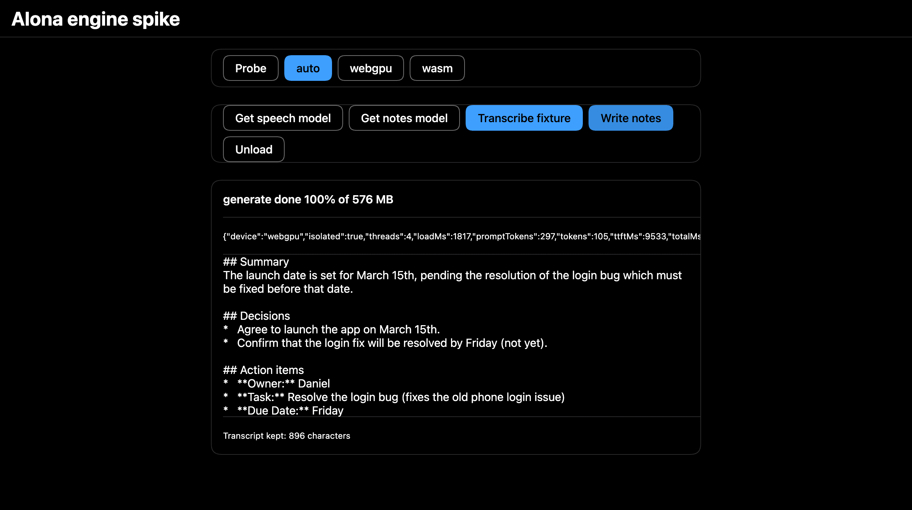

# Spike S1: local speech-to-text and LLM in an Exact web app

Date: 2026-11-14. Goal: prove that an Exact web app can transcribe a meeting and write meeting notes entirely in the browser, through Exact's native-module seam (`native.later` answered by `modules/web/index.js`), and measure it.

Machine for every number below: an Apple Silicon Mac (12 logical cores, `navigator.deviceMemory` 32). The browser was Google Chrome 157 (headed, driven by the Chrome DevTools MCP), with WebGPU on Metal (`architecture: metal-3`, `shader-f16: true`, `maxBufferSize` 4 GiB). Exact's own agent runs HeadlessChrome 156. The audio is the 53 s synthetic three-speaker fixture.



## Verdict

| Acceptance line | Verdict | Evidence |
|---|---|---|
| The fixture transcribes in the browser through the seam, with WER and wall time | **VERIFIED** | Moonshine base, WebGPU: 6.55% WER (11 errors / 168 words), 3.36 to 3.66 s to transcribe 53 s of audio once loaded. WASM gives identical text. |
| The LLM turns the transcript into notes with summary, decisions, and action items | **VERIFIED, with a quality caveat** | Qwen3.5-0.8B q4f16 on WebGPU: 34.96 to 43.32 tok/s decode, TTFT 8.9 to 10.6 s for a 297-token prompt. It produced all three sections, but it dropped Karen's action items. WASM works but is too slow for use (0.53 tok/s single-threaded, 2.0 tok/s with 4 threads). |
| Download size, load time, peak memory, memory after `unload` over three cycles | **VERIFIED** (memory is process RSS, method below) | 157.5 MB STT and 603.9 MB LLM on the wire for WebGPU. Cached load 0.8 to 1.8 s. Peak renderer plus GPU-process RSS was 3.86 GB. `dispose()` does not return memory, but the level does not grow across cycles. Terminating the worker does return it. |
| Screenshot of the working spike screen | **VERIFIED** | `web-engine.png`, taken after clicking Transcribe, Use as transcript, and Write notes in the UI. |

## Answers to the six questions

### 1. Dependencies, WASM assets, CSP, grants, and what `web-build` serves

- **Exact does not bundle the page module.** `host/web/build.mjs` copies the whole `modules/web/` folder verbatim to `modules/` in the output (`copyStaticTreeIfPresent`). `host/web/native-glue.js` then loads `./modules/index.js` with a dynamic `import()` after first paint. So any sibling file is served too: a bundled worker, `.wasm`, `.mjs`. `web-build --out dist` produced `dist/modules/{index.js, worker.js, bench.js, ort/*}`. The whole `dist` was 42 MB, and the ONNX Runtime wasm made up most of it.
- **The build imports `modules/web/index.js` in Bun** (`await import(app.modules.web)` to read `roster`). The page module must therefore touch no browser API at the top level. The spike creates the Worker lazily inside `later()`.
- **What worked: pre-bundle and vendor.** `bun build` bundles `@huggingface/transformers@4.3.2` (with `onnxruntime-web` 1.31.0-dev.20260914) into one 0.56 MB ESM `worker.js`. The matching ORT runtime files are copied into `modules/web/ort/`, and `env.backends.onnx.wasm.wasmPaths` points there. Only `ort-wasm-simd-threaded.asyncify.{mjs,wasm}` (26.9 MB) loaded, because this ORT build serves WebGPU and WASM from one binary. No CDN is used at runtime. transformers.js otherwise defaults to jsDelivr for the ORT wasm.
- **Do not use `transformers.min.js` prebuilt.** It embeds ORT `1.31.0-dev.20260911`, while its package.json pins `…20260914`. That risks a glue and wasm mismatch if the wasm is vendored from npm. Bundling from source avoids it.
- **CSP.** The dev server sends only `content-security-policy: frame-ancestors …` (checked with `curl -I`). `exact serve` and static hosts send no CSP (per `scripts/app.schema.json` `host.web.csp`). The Rust render server sends `default-src 'self'; script-src 'self' 'wasm-unsafe-eval' …; connect-src 'self' <origins from net.fetch grants>; worker-src 'self' blob:` (`host/render/src/csp.rs`). So `'wasm-unsafe-eval'` and same-origin workers are already admitted. Model downloads from Hugging Face would need `net.fetch https://huggingface.co` plus its redirect CDN hosts in the grants, or `host.web.csp.connect-src`. **NOT VERIFIED** under the render server, which the spike did not run.
- **Grants.** `app.ts` needed no grant: `native.later` is not grant-gated, and the page module's own `fetch` is ordinary page code. `grants = ''` in the spike.

### 2. Cross-origin isolation

- **Not available from Exact today.** No Exact server (dev `host/web/dev.mjs`, `serve.mjs`, `agent-web.mjs`, the render server) sends COOP/COEP. A grep for `Cross-Origin-Opener` finds only auth glue. `app.json` has no headers key. Probe: `crossOriginIsolated: false` and no `SharedArrayBuffer` in both the dev server and the agent's headless Chrome.
- **Exact's page does work isolated.** The production `dist` was served with a 15-line Bun server adding `COOP: same-origin` and `COEP: require-corp` (`tools/coi-serve.mjs`, toggled by a flag file so that the origin and model cache stay the same). The page rendered all its buttons, and Hugging Face downloads still worked under `require-corp`.
- **Measured cost on the same origin.** WASM STT took 12.96 s with 1 thread unisolated and 4.75 s with 4 threads isolated (2.7x). WASM LLM decode ran at 0.53 tok/s unisolated and 2.0 tok/s isolated (3.8x), with TTFT of 17.4 s and 4.7 s. WebGPU does not depend on isolation: its numbers were the same in both modes.

### 3. WebGPU

- **Real Chrome 157:** works. Adapter `apple / metal-3`, f16 supported. It ran both models.
- **Exact's headless agent (HeadlessChrome 156):** `navigator.gpu.requestAdapter()` returns an adapter, but it is `google / swiftshader`, a CPU emulation. A naive `if (navigator.gpu)` check would choose a software GPU. Production must treat `architecture == "swiftshader"` (or `adapter.info.isFallbackAdapter`) as no WebGPU. Model runs under the agent were not timed.
- **WASM fallback speeds** are in question 2 and the table. For STT, WASM is usable (4.2x real time single-threaded, 11x with threads). For the LLM, it is not usable at any thread count tried.

### 4. Where an @exact/recording file lands on the web

From source (`packages/recording/web/index.js`, `host/web/storage-fs.js`), not exercised with a real microphone in this spike:

- The recorder writes to the `app:/…` path the app passes, appending each `MediaRecorder` slice every second. It flushes the rest at `pagehide`.
- The container is the first of `audio/mp4`, `audio/webm`, `audio/ogg` that the browser can write. MP4 comes first because Chrome's WebM has no duration in the header. Under the agent, the file is a synthetic 16-bit PCM WAV.
- The bytes live in IndexedDB database `exact-storage:<app id>`, object store `files`, as records `{path, kind: 'file', contents: Blob | Uint8Array, modifiedMs}`.
- **How the page module reads it:** open that IndexedDB, get the record by path, and pass `contents` to `decode16k()`. `decode16k()` already turns any browser-decodable audio into 16 kHz mono Float32 via `OfflineAudioContext(1, 1, 16000).decodeAudioData`. That decode path is VERIFIED on the WAV fixture: 11 to 14 ms for 53 s. The IndexedDB read and decoding of a real MP4 or WebM recording are **NOT VERIFIED**.
- The other route, `app.ts` reading the file with `storage.fs.readFile` and passing it through `native.later`, would push base64 audio through JSON. Avoid it for meetings: an hour of Opus is tens of MB.
- Reading Exact's IndexedDB layout directly couples the page module to a private storage format. Ask Exact for a supported way for a page module to read an `app:/` file.

### 5. Model cache, limits, eviction

- transformers.js caches every model file in the Cache API, cache name `transformers-cache`, keyed by URL. After the STT download, `navigator.storage.estimate().usage` was 157,506,816 bytes over 7 entries. A cached load took 0.77 to 1.2 s for STT and 1.06 to 2.3 s for the LLM, with no network.
- The quota reported here was 10.9 GB, with `persisted: false` (this Chrome profile, a 10 GB-class quota). The WebGPU Lite pair needs 761 MB. The WASM LLM variant needs 1.0 GB more, because it must use the fp16 embedding (see failures).
- Eviction is best-effort until `navigator.storage.persist()` is granted. The page module has a `persist` op, but whether Chrome grants it to this app was **NOT VERIFIED**. Detection: at launch, compare `caches.open('transformers-cache')` keys (or `caches.match` on each expected file URL) with the manifest of files the tier needs, and report "needs download" when any is missing. A cache entry is all or nothing per file, so a missing key is the signal. Resumable downloads are **NOT IMPLEMENTED**: transformers.js re-fetches a whole file that was interrupted. Resume needs our own Range-request downloader writing to OPFS.

### 6. Do `native.later` jobs survive route changes and reloads, and how to poll

- **Route change: yes, by construction.** `native-glue.js` loads the artifact once per page (`globalThis.exact.nativeArtifact`), so the module's `jobs` map and its Worker live as long as the document. This was not exercised (the spike has one route).
- **Reload: no. VERIFIED.** A dev-loop rebuild reloaded the page mid-session. The Worker, its loaded models, and every job were gone, and `status` of an old id answers `state: "unknown"`. The model files stay in the Cache API, so recovery is a cached load of about 1 s, not a re-download.
- **Polling shape that worked:** a mutation starts the job and returns `{job}`. Then `resource status = jobStatus(job) when job != "" as shape Job else empty()`, and `task poll when running` with `every(500, pull)` where `pull` does `refresh status`. The task stops by itself when the state leaves `running`. Contract has no `resource … interval=`. A `task` with `every` is the only timer (the `rest` pattern does the same). In agent tests the clock is virtual, so real model jobs need `clock … real` steps. The committed tests avoid models.

## Measured numbers

| Measurement | Value | Method |
|---|---|---|
| STT WER (Moonshine base, onnx-community, encoder fp32 and decoder q4) | 6.55% (11 / 168) | `tools/wer.py`: lowercase, strip punctuation, word Levenshtein against `reference.txt`. Several errors are numerals ("20" for "twenty", "15th" for "fifteenth"). WebGPU and WASM text are identical. |
| STT time, WebGPU | 3.36 to 3.66 s for 53 s of audio (14.5 to 15.8x real time); first-ever run 4.91 s | `performance.now()` around the inference loop in the worker, 20 s windows. 5 runs. |
| STT time, WASM | 12.75 s and 12.96 s (1 thread), 4.75 s (4 threads, isolated) | Same method |
| Audio decode to 16 kHz mono | 11 to 14 ms | `OfflineAudioContext.decodeAudioData` on the page |
| LLM decode speed, WebGPU (q4f16) | 34.96 to 43.32 tok/s (7 runs) | `TextStreamer` token callback: (tokens − 1) / (end − first token) |
| LLM TTFT, WebGPU | 0.69 s at 15 prompt tokens, 8.9 to 10.6 s at 297, 21.6 s at 729 | Time from `generate()` to the first token callback. **Prefill is linear at about 30 ms per token, the same rate as decode.** See risks. |
| LLM, WASM (embed fp16, decoder q4) | 0.53 tok/s with 17.4 s TTFT (1 thread); 2.0 tok/s with 4.7 s TTFT (4 threads) | Same method, 60 to 105 tokens |
| Wire size, WebGPU set | STT 157,499,295 B (7 files); LLM 603,944,951 B (8 files, q4f16 decoder plus embedding); ORT wasm 26,861,777 B from own origin | Sum of `progress_callback` file totals (Content-Length) from transformers.js. Hugging Face serves these binaries uncompressed, but transfer size was not checked in the network panel. |
| Wire size, WASM LLM set | 1,014,100,785 B | Same method |
| First load including download | STT 8.2 s; LLM 16.1 to 17.3 s (WebGPU), 21.5 s and 138.3 s (WASM set, two runs on a variable network) | `from_pretrained` wall time in the worker |
| Cached load | STT 0.77 to 1.20 s; LLM 1.06 to 2.34 s | Same method, after `unload` |
| Peak memory | Tab renderer 2.95 GB plus GPU process 0.92 GB, about 3.86 GB together, in cycle 3's LLM phase. STT phase peak was 2.04 GB together in cycle 1. | `ps` RSS of the DevTools Chrome's tab renderer (which hosts the dedicated worker) and its GPU process, sampled every 0.5 s (`tools/sample.sh`, `tools/rss-phases.py`). Fresh tab, isolated origin. Baseline at the first mark: renderer 610 MB, GPU 365 MB. |
| JS heap | 2 to 9 MB on the page | `performance.memory.usedJSHeapSize`. This misses the worker and all WASM and GPU memory, so it is not useful here. |
| Memory after `unload` (`dispose()`), cycles 1/2/3 | Renderer 2140 / 2401 / 2367 MB; GPU 794 / 797 / 798 MB | Same RSS sampling, 3 s after unload. No growth across cycles, but nothing is returned either. |
| Memory after terminating the worker | Renderer 1289 MB; GPU 377 MB (back to baseline) | `unload {terminate: true}`, 3 s later |

`navigator.storage.estimate()` and the WASM linear memory size were not used for memory: ORT does not expose its heap size, and WebGPU buffers are not in it.

## Notes output (WebGPU, unedited)

The prompt was a fixed system prompt asking for exactly three sections, plus the timestamped transcript (297 tokens), greedy decoding, `repetition_penalty` 1.1:

```
## Summary
The launch date is set for March 15th, pending the resolution of the login bug which must be fixed before that date.

## Decisions
*   Agree to launch the app on March 15th.
*   Confirm that the login fix will be resolved by Friday (not yet).

## Action items
*   **Owner:** Daniel
*   **Task:** Resolve the login bug (fixes the old phone login issue)
*   **Due Date:** Friday
```

It has the right shape, but it is incomplete. It misses Karen's three items (icons by Thursday, release notes, screenshots) and Daniel's Friday regression run, and it splits one action item into three bullets. This matches the research doc's warning that 0.8B output is a draft.

## What failed and why

- **Qwen3.5 q4 and int8 embeddings on WASM:** `Could not find an implementation for GatherBlockQuantized(1) node … /model/embed_tokens/Gather_Quant`. ORT's WASM backend has no kernel for it. The fp16 embedding works, at 508 MB instead of 147 MB.
- **WASM LLM speed:** 0.53 tok/s single-threaded, 2.0 tok/s with 4 threads. A 400-token note would take 3 to 12 minutes, so this is not a usable fallback. The cause was not profiled. Decode is far slower than prefill on WASM (prefill about 63 tok/s isolated), which points to a per-token cost such as the 248K-vocab output head.
- **`@moonshine-ai/moonshine-wasm` and `@wllama/wllama`:** installed, but not tried within the timebox. transformers.js covered both models with one runtime and one cache. The Lite pick in the research doc, Moonshine *Streaming* Small, is not what ran. The spike ran `onnx-community/moonshine-base-ONNX`, the non-streaming base model that transformers.js supports.
- **`onnx-community/Qwen3.5-0.8B-ONNX-OPT`:** the model card marks it as the newer export. It is registered in the worker as `qwen3.5-0.8b-opt`, but it was not measured. It may change the prefill rate.
- **Dev-loop reload:** editing a file under `modules/web` reloads the page and kills running jobs. Expect this during development.

## Recommended design for the production page module

**File layout** (all under `modules/web/`, copied verbatim by Exact):

- `index.js` holds the seam: `later(request)`, the job table, the audio decode, and the probe. It has no top-level browser access, because Bun imports it at build time.
- `worker.js` is the engine, generated by `bun build` from `engine/worker.src.js` in a sibling package with its own `package.json`. It is checked in, or generated by an app.json `commands` verb.
- `ort/ort-wasm-simd-threaded.asyncify.{mjs,wasm}` is ORT's runtime, copied from the same `onnxruntime-web` version the bundle resolved. Assert the version match in the build script.

**Worker protocol:** in, `{id, op, …}`; out, `{id, type: 'progress' | 'partial' | 'done' | 'error', …}`. `index.js` keeps `jobs: Map<id, {op, state, progress, partial, result, error, startedAt, endedAt}>`. The Contract-facing reply is a flat shape (`job, op, state, loaded, total, partial, text, metrics, error`). Every long op (`download`, `transcribe`, `generate`) returns `{job}` at once and is polled with `status`. `unload` terminates the Worker rather than calling `dispose()`, because only termination returned memory. Run STT and LLM strictly in sequence, with a terminate between them.

**Caching:** keep transformers.js's Cache API store for the spike tier. Add a per-tier manifest (file URL, byte size) so the app can show "needs download" and detect eviction at launch. Request `navigator.storage.persist()` after the first successful download. Write our own Range-request downloader into OPFS before shipping, for resumable downloads of files of 500 MB and more.

**Dependency loading:** pre-bundled and vendored only, with no CDN. Pin `@huggingface/transformers` and `onnxruntime-web` exactly.

**Device choice:** use WebGPU only when the adapter is not a fallback (`swiftshader`) and has `shader-f16`. Otherwise use WASM for STT only, and tell the user that notes need a WebGPU browser or the native app.

**Recording input:** read the `app:/` recording from Exact's IndexedDB in the page module (or through a supported Exact API, once asked for), decode with `OfflineAudioContext` at 16 kHz, and transfer the `Float32Array` buffer to the worker.

## Open risks

1. **Prefill rate kills long meetings.** TTFT grew linearly at about 30 ms per prompt token on WebGPU. At that rate the research doc's Lite one-shot budget of 3K tokens takes about 90 s before the first token. A 15K-token hour-long meeting would take about 7.5 minutes of prefill alone, before map-reduce overhead. This was measured on one machine with one export. Measure the `-ONNX-OPT` export and wllama with the GGUF file before accepting the Lite LLM in the browser.
2. **No WASM path for notes.** Browsers without a real WebGPU adapter (the agent's headless Chrome, some Android and Linux browsers) cannot write notes in reasonable time.
3. **Cross-origin isolation needs host support.** Threads gave a 2.7x to 3.8x WASM speedup, but Exact servers do not send COOP/COEP. This needs an Exact feature (for example a `host.web.headers` key or an isolation flag), or a deployment host configured outside Exact. COEP `require-corp` also blocks any cross-origin embed without CORP.
4. **Memory.** Process RSS reached about 3.9 GB for a 0.8B model with STT also loaded in the UI run. The research doc estimated 0.8 GB. Part of RSS may be mapped or reclaimable memory, which this method cannot separate. Test on an 8 GB machine and on mobile Safari, where per-tab limits are lower.
5. **Notes quality at 0.8B** dropped half the action items on a 53 s meeting.
6. **Private storage coupling** for reading recordings (question 4).
7. **Untested here:** Safari and Firefox, iOS WebKit, the render-server CSP for Hugging Face fetches, eviction, `persist()`, and a real microphone recording.

## Spike code

`/private/tmp/claude-501/-Users-manlikeabro-Documents-repos-alona/6b40fa8d-2378-4789-9c09-a3bb732155a9/scratchpad/spikes/web/`:

- `alona-web-spike/` is the Exact app: `app.contract`, `app.ts`, `app.test.contract` (2 model-free tests, both pass with `bun exact.mjs test web`), `modules/web/{index.js, worker.js, bench.js, ort/}`, and `assets/meeting-fixture.wav`.
- `deps/src/worker.src.js` is the worker source. Rebuild it with `bun build src/worker.src.js --target=browser --format=esm --minify --outfile=../alona-web-spike/modules/web/worker.js`.
- `tools/` holds `wer.py`, `coi-serve.mjs`, `rss.sh`, `sample.sh`, and `rss-phases.py`.
- `results/` holds the STT hypothesis text, the raw RSS samples, and the phase marks.
- `dist/` is the `web-build` output that was measured under isolation.
